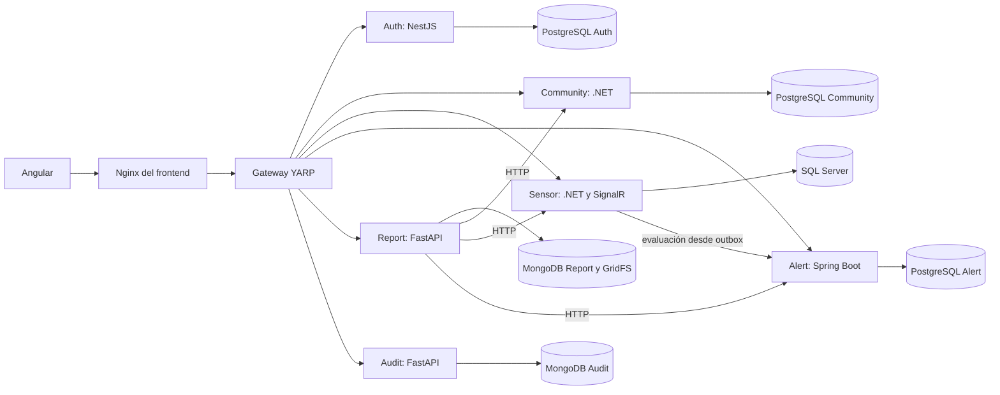

# Documentación técnica del proyecto

Sistema de Monitoreo y Alerta Temprana para Riesgos Climáticos.

Actualizada el 23 de octubre de 2026 a partir del código del repositorio. Describe la arquitectura activa; el monolito permanece en el historial de Git. Las instrucciones de operación no certifican disponibilidad de la VPS.

[Repositorio del proyecto](https://github.com/javier6441112/Monitoreo-y-alerta-temprana-de-riesgos-climaticos)

| Integrante | Carné |
|---|---|
| Tedi Castellanos | 7690-23-3016 |
| Javier Sandoval | 7690-23-5643 |

## 1. Propósito y alcance

Administrar comunidades, sensores y lecturas ambientales; evaluar umbrales configurables; mostrar alertas, dashboard e historial; registrar auditoría y producir reportes PDF. Las variables incluyen temperatura, humedad, viento, lluvia y nivel de río; la semilla también incorpora humo.

Las alertas representan coincidencias con reglas, no predicciones meteorológicas certificadas. Los datos de demostración y sus umbrales requieren validación antes de cualquier uso real.

## 2. Arquitectura activa



El diagrama resume flujos principales. También hay introspección hacia Auth, consultas de enriquecimiento y envío de eventos hacia Audit. En la VPS puede existir un Nginx del host que termina HTTPS y reenvía al frontend; no está incluido en Compose por defecto.

| Componente | Tecnología declarada | Responsabilidad | Código |
|---|---|---|---|
| Frontend | Angular 20, TypeScript, Material, RxJS | Interfaz y cliente SignalR | `Frontend/` |
| Gateway | .NET 10, YARP | Enrutamiento, acceso inicial, CORS, límites y dashboard | `Gateway/` |
| Auth | Node 24, NestJS, TypeScript | Usuarios, contraseñas, roles, permisos y sesiones | `Services/Auth/` |
| Community | .NET 10, Npgsql | Comunidades y geografía | `Services/Community/` |
| Sensor | .NET 10, SQL Server, SignalR | Sensores, lecturas, simulación y outbox | `Services/Sensor/` |
| Alert | Java 21, Spring Boot 3.5.11 | Reglas, alertas e historial | `Services/Alert/` |
| Report | Python 3.12, FastAPI, Jinja2, WeasyPrint | Generación y almacenamiento de PDF | `Services/Report/` |
| Audit | Python, FastAPI, PyMongo | Recepción y consulta de auditoría | `Services/Audit/` |

`Services/Platform/Platform.cs` comparte infraestructura .NET; `Services/PythonCommon/` comparte seguridad, HTTP y errores Python. No se comparte un modelo de entidades entre todos los dominios.

## 3. Estructura y refactorización

```text
Frontend/                 Angular y Nginx del contenedor
Gateway/                  Proxy YARP y dashboard
Services/                 Seis servicios e infraestructura compartida
infra/mongo/              Inicialización de usuarios MongoDB
infra/nginx/              Ejemplo HTTPS para la VPS
scripts/                  Entorno, semilla y verificadores
Tools/Migration/          Importación administrativa histórica
docs/fase-3/              Operación, semilla y defensa
docker-compose.yml        Despliegue activo y perfil demo
.env.example              Plantilla sin secretos reales
```

Se retiraron `Backend/`, `BaseDeDatos/`, pruebas del monolito y configuraciones antiguas del frontend. Angular arranca desde `Frontend/src/main.ts`, con `app.config.ts` y `app.routes.ts`. Los documentos anteriores de diseño y contratos se conservan como históricos.

## 4. Persistencia

| Propietario | Gestor | Entidades | Inicialización |
|---|---|---|---|
| Auth | PostgreSQL 17 | users, revoked_tokens, role_permissions, external_identities, schema_versions | `Services/Auth/src/main.ts` |
| Community | PostgreSQL 17 | communities | `Services/Community/Program.cs` |
| Sensor | SQL Server 2022 | sensors, readings, evaluation_outbox, monitor_settings | SensorSchema en `Services/Sensor/Program.cs` |
| Alert | PostgreSQL 17 | rules, alerts, events, evaluation_receipts | `Services/Alert/src/main/resources/schema.sql` |
| Report | MongoDB 8 | Metadatos y PDF en GridFS | `Services/Report/main.py` |
| Audit | MongoDB 8 | Eventos con eventId único | `Services/Audit/main.py` |

Los tres servicios PostgreSQL tienen instancias separadas, aunque actualmente comparten el valor `POSTGRES_PASSWORD`. Report y Audit comparten instancia MongoDB, con bases y usuarios distintos. Cada servicio consulta datos ajenos mediante APIs. La herramienta administrativa de importación es una excepción fuera del tráfico normal.

Los volúmenes auth-data, community-data, sensor-data, alert-data y mongo-data conservan datos. `DATA_VOLUME_PREFIX` determina sus nombres reales: cambiarlo puede seleccionar bases nuevas. Recrear contenedores no migra datos. La inicialización del esquema no sustituye migraciones versionadas para futuras modificaciones.

## 5. APIs y contratos

Las rutas se configuran en `Gateway/Program.cs`; los servicios definen operaciones y validaciones.

| Ruta | Destino o función |
|---|---|
| `POST /api/auth/login` | Login público; token, tokenType, expiresAt y user |
| `/api/auth/me`, `/api/auth/logout` | Identidad y cierre de sesión |
| `/api/usuarios`, `/api/roles` | Administración en Auth |
| `/api/comunidades` | Community; alias `/api/communities` |
| `/api/sensores`, `/api/lecturas`, `/api/monitoreo` | Sensor; alias `/api/sensors` |
| `/hubs/monitoreo` | SignalR autenticado |
| `/api/configuracionalertas`, `/api/alertas`, `/api/historial` | Alert; alias `/api/alerts` |
| `/api/reports` | Generación, historial, detalle y descarga |
| `/api/bitacora`, `/api/audit` | Audit; requiere ADMIN |
| `/api/dashboard`, `/api/dashboard/series` | Composición en Gateway por HTTP |
| `/health`, `/ready` | Salud y disponibilidad; Gateway comprueba dependencias |

Las consultas de dominio generalmente devuelven listas. La paginación usa `page` desde 1 y `pageSize` máximo 200. Reportes devuelve `{items, page, pageSize, total}`. Los filtros dependen del recurso: sensorId, comunidadId, desde, hasta, tipo, nivel y fenomeno. Se usan fechas ISO 8601 y límites de consulta inclusivos.

Respuestas relevantes: 400 datos inválidos, 401 autenticación inválida, 403 permisos insuficientes, 404 recurso inexistente, 409 conflicto, 413 exceso de filas y 429 límite de solicitudes. Las dependencias pueden producir 502/503. Hay respuestas de problema para errores de aplicación; algunos rechazos de autenticación no incluyen cuerpo.

## 6. Seguridad

`Services/Auth/src/password.ts` implementa PBKDF2-SHA256 con salt aleatorio, 100 000 iteraciones y comparación segura. Auth emite JWT HS256 con emisor, audiencia, usuario, identificador de token, rol, permisos y versión de sesión.

**El token dura una hora.** En `Services/Auth/src/main.ts`, `expiresIn:1*60*60` y `expiresAt` representan la misma duración. Cambiarla requiere reconstruir Auth y obtener un token nuevo; no altera tokens existentes. No hay refresh token implementado.

Gateway y servicios verifican firma, algoritmo, issuer, audience y expiración. La introspección comprueba usuario activo, revocación y versión. Logout registra el jti en revoked_tokens; cambios de usuario y permisos invalidan sesiones mediante token_version. Auth es una dependencia de disponibilidad para operaciones protegidas.

Roles: ADMIN, OPERADOR y CONSULTA. Los permisos de reportes son reports:generate, reports:read y reports:download; descargar exige además ADMIN. La autorización efectiva se verifica en backend, además de las guardas de Angular.

Las APIs internas requieren X-Service-Key. Gateway no las publica y elimina ese encabezado si viene del cliente. HS256 y la clave interna son secretos compartidos: su posesión permite firmar o realizar llamadas internas respectivamente. La firma asimétrica, rotación e identidad por llamante son mejoras pendientes. external_identities prepara el modelo, pero no acredita login OAuth/OIDC externo.

Angular guarda token y usuario en localStorage. Su isAuthenticated() comprueba presencia del token; la validez se decide en backend. Se debe prevenir XSS y mejorar el manejo de sesión. CORS aplica a navegadores según CORS_ORIGINS y no impide solicitudes desde Postman.

## 7. Lecturas, alertas y SignalR

1. ReadingWriter valida sensor y actividad, y consulta reglas activas en Alert.
2. Una transacción SQL Server guarda lectura, último valor y evaluation_outbox.
3. EvaluationWorker reserva trabajo con bloqueo y vencimiento temporal, y llama a `/internal/evaluate`.
4. Alert registra reading_id único y evalúa reglas dentro de una transacción PostgreSQL. Un reintento no duplica la alerta de esa lectura.
5. Sensor elimina el trabajo tras evaluación exitosa o lo reprograma ante fallos. SignalR comunica actualizaciones.

Hay consistencia eventual, sin transacción distribuida. La outbox protege trabajo confirmado; si Alert falla durante la consulta inicial de reglas, una lectura nueva puede no registrarse.

Niveles: VERDE, AMARILLO, NARANJA y ROJO. Las reglas contienen tipo, fenómeno, límites, mensaje y actividad. El evaluador selecciona una coincidencia y conserva valor y umbrales aplicados en la alerta; no genera necesariamente una alerta por cada regla coincidente.

La simulación está apagada por defecto. ADMIN la habilita con `POST /api/monitoreo/reiniciar` y la detiene mediante `PATCH /api/monitoreo/estado`, cuerpo `{"activo":false}`. El estado persiste en SQL. Los sensores activos sin lectura en quince minutos se consideran sin comunicación. Falta coordinación del simulador y backplane SignalR entre réplicas.

Audit recibe eventos con eventId único. Sus emisores registran fallos, pero no tienen outbox durable de auditoría; no se garantiza recuperar todo evento perdido por indisponibilidad.

## 8. Reportes PDF

Report obtiene datos mediante APIs, genera HTML con Jinja2 y PDF con WeasyPrint. MongoDB conserva metadatos y GridFS el archivo. `Services/Report/templates/report.html` incluye logo, fecha UTC, usuario, filtros, tablas y numeración.

Tipos: COMMUNITIES, SENSORS, READINGS, ALERTS, EVENTS, SENSOR_STATUS, CLIMATE_STATISTICS y EXECUTIVE.

```http
POST /api/reports
Authorization: Bearer TOKEN
Content-Type: application/json
Idempotency-Key: ejemplo-lecturas-001

{"type":"READINGS","filters":{"comunidadId":1,"sensorId":2}}
```

| Operación | Ruta |
|---|---|
| Generar | `POST /api/reports` |
| Historial | `GET /api/reports?page=1&pageSize=20` |
| Detalle | `GET /api/reports/{id}` |
| Descargar | `GET /api/reports/{id}/download` |

Metadatos: identificador, tipo, usuario, fecha, filtros, estado, nombre, filas y fecha de descarga. Estados: GENERATING, COMPLETED y FAILED. Idempotency-Key es opcional y está aislada por usuario: clave y contenido iguales reutilizan el registro; parámetros diferentes responden 409. ADMIN consulta el conjunto; otros usuarios autorizados consultan sus propios reportes.

La generación es síncrona, con lotes de hasta 200 y máximo 10 000 filas por conjunto. No hay cola de generación. downloadedAt se registra al completar la lectura del flujo del archivo en el servidor. Las estadísticas integran tasas de lluvia por intervalos, sin sumar mm/h como cantidades acumuladas. El renderizador restringe recursos externos y archivos; Jinja2 escapa contenido.

## 9. Configuración e instalación

Requiere Docker Engine/Compose con contenedores Linux o Docker Desktop. Las imágenes incluyen runtimes y gestores; Node 24 en el host se necesita solo para ejecutar directamente scripts Node.

| Variable | Función |
|---|---|
| JWT_KEY, SERVICE_KEY | Claves distintas y aleatorias de al menos 32 bytes |
| POSTGRES_PASSWORD, MSSQL_SA_PASSWORD | Credenciales relacionales; SQL Server exige complejidad |
| MONGO_ROOT_PASSWORD, MONGO_REPORT_PASSWORD, MONGO_AUDIT_PASSWORD | Credenciales MongoDB |
| ADMIN_USERNAME, ADMIN_PASSWORD | Crea el administrador si no existe ese username; no cambia contraseñas existentes |
| API_PORT, FRONTEND_PORT | Puertos por defecto 5000 y 4200 |
| BIND_ADDRESS | Dirección publicada; por defecto 127.0.0.1 |
| CORS_ORIGINS | Orígenes permitidos separados por coma |
| DATA_VOLUME_PREFIX | Nombres de volúmenes |
| SEED_USERNAME, SEED_PASSWORD, DEMO_PASSWORD | Opcionales de la semilla |

Crear `.env` junto a docker-compose.yml con valores reales. No versionarlo. Las contraseñas en URI requieren codificación si contienen caracteres reservados; el generador usa hexadecimal.

Windows, instalación nueva:

```powershell
powershell -NoProfile -ExecutionPolicy Bypass -File scripts/init-env.ps1
docker compose up -d --build --wait --wait-timeout 240
```

El inicializador rechaza sobrescribir `.env`. En Linux, únicamente si todavía no existe:

```bash
cp .env.example .env
nano .env
chmod 600 .env
docker compose config --quiet
docker compose up -d --build --wait --wait-timeout 240
```

Reemplazar todos los valores de ejemplo. Modificar contraseñas de entorno después de inicializar bases no actualiza sus credenciales internas.

Acceso local: frontend http://localhost:4200, reportes /reportes, Gateway http://localhost:5000. Angular usa `/api` y `/hubs/monitoreo` relativos al origen del frontend.

## 10. Semilla de demostración

Con los servicios activos:

```bash
docker compose --profile demo run --rm seed-demo
```

Crea dos usuarios demo, una comunidad, seis sensores, diez reglas, lecturas y ocho PDF mediante APIs. Alertas, historial y auditoría se producen por los flujos normales. El perfil demo no se ejecuta durante un arranque estándar.

Las contraseñas nuevas se muestran solo al crear usuarios. Se conservan registros existentes; ejecutar una sola instancia a la vez. Los PDF se reutilizan por clave y administrador. Las reglas son globales por tipo de sensor y pueden participar en otras lecturas; los umbrales son ilustrativos. No hay transacción global y un fallo puede dejar pasos completados. Ver conflictos, credenciales y recuperación en [SEMILLA_DEMO.md](docs/fase-3/SEMILLA_DEMO.md).

## 11. Operación y VPS

```bash
docker compose ps
docker compose logs -f --tail=100 gateway
docker compose logs --tail=100 auth sensor alert report
docker compose up -d --build auth
```

Para actualizar, traer la revisión deseada y ejecutar `docker compose up -d --build --wait`, conservando `.env` y prefijo de volúmenes. Respaldar y revisar cambios de esquema antes. Volver a código anterior no revierte automáticamente las bases.

Compose publica frontend y Gateway; los demás servicios y bases están en la red backend interna. Si Nginx corre en el host, mantener Docker enlazado a localhost y dirigir el proxy al frontend, normalmente `http://127.0.0.1:4200`.

`infra/nginx/https.conf.example` requiere dominio, certificados y activación en el host; no instala ni renueva certificados. DNS, TLS y conectividad del dominio deben comprobarse en la VPS. Un certificado activo en un intermediario no acredita conectividad al origen.

Ante un 504:

```bash
curl -I --max-time 10 http://127.0.0.1:4200
curl --max-time 10 http://127.0.0.1:5000/ready
sudo nginx -t
sudo tail -n 40 /var/log/nginx/error.log
```

Ajustar puertos si fueron cambiados. Revisar destino del proxy, estado de servicios, DNS, TLS y encabezado Host antes de aumentar timeouts. El 504 reportado en la VPS sigue pendiente de diagnóstico; no se acredita aquí su resolución.

Nginx del frontend omite la query en sus logs y Platform reduce logs de hosting/YARP para limitar exposición de tokens SignalR. El código actual puede emitir mensajes informativos de health checks y llamadas internas; no se presupone filtrado por ruta.

## 12. Verificación

| Archivo | Alcance |
|---|---|
| scripts/seed-demo.test.mjs | Simula APIs: reejecución, fallo parcial y regla modificada |
| Services/Auth/test/password.test.cjs | Hashes; requiere dependencias y compilación de Auth |
| Services/Alert/src/test/java/com/weatherrisk/alert/RulesTest.java | Umbrales inclusivos y reglas inactivas |
| Services/Report/test_reports.py | Lluvia y restricciones del renderizador |
| scripts/verify-microservices.mjs | Integración real; crea datos y evidencias |
| scripts/verify-persistence.mjs | Requiere artifacts/integration-results.json y datos de la integración |
| scripts/verify-failure.mjs | Supone Alert detenido; readiness, errores y reporte FAILED |
| Tools/Migration/test_migration.py | Validaciones del importador histórico |

```bash
node --test scripts/seed-demo.test.mjs
node scripts/verify-microservices.mjs
node scripts/verify-persistence.mjs
docker compose exec -T report python -m unittest test_reports -v
```

Los verificadores de integración necesitan credenciales válidas; INTEGRATION_USERNAME e INTEGRATION_PASSWORD pueden sustituir las de bootstrap. Usar entorno de prueba. verify-failure no detiene Alert por sí mismo. Los resultados históricos de MICROSERVICIOS.md no sustituyen pruebas actuales ni acreditan disponibilidad de la VPS.

## 13. Migración, respaldos y pendientes

Tools/Migration conserva importación administrativa con validación de relaciones y hashes. Los Compose anteriores se retiraron: preparar explícitamente conexiones y destinos; no ejecutar --apply sobre bases en uso. Las exportaciones son privadas.

Un respaldo completo cubre las tres bases PostgreSQL, SQL Server, MongoDB con GridFS y configuración privada. Los volúmenes no son respaldos. Falta automatizar y comprobar una restauración integral.

Pendientes: verificar dominio, TLS y renovación en VPS; contrastar Angular 22+ requerido con versión 20 declarada; auditoría durable; disponibilidad de reglas; simulación y SignalR entre réplicas; pruebas CRUD, carga y fallos; separar archivos extensos; firma asimétrica y rotación; autenticación externa; validación meteorológica y recuperación de datos. Compose no equivale a un despliegue Kubernetes.

## 14. Documentación relacionada

- [Microservicios y antecedentes](docs/fase-3/MICROSERVICIOS.md).
- [Semilla de demostración](docs/fase-3/SEMILLA_DEMO.md).
- [Seguimiento de fase 3](TAREAS_FASE_3.md).
- [Diseño histórico](docs/fase-3/ARQUITECTURA.md).
