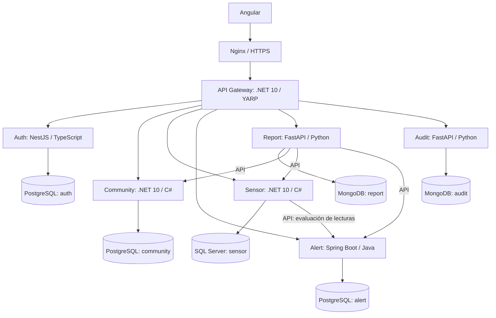

> Documento historico de una etapa anterior. El codigo monolitico fue retirado. Consultar el [README](../../README.md) para la arquitectura activa.

# Reingeniería de fase 3

> Registro del primer incremento de diseño y refactorización. La extracción ya se implementó: consultar [Microservicios: implementación y operación](MICROSERVICIOS.md) para el estado vigente.

## Estado de este incremento

El sistema sigue desplegándose como un monolito .NET 10 con SQL Server. Se separaron los contratos y las implementaciones de persistencia por dominio; este cambio todavía no crea microservicios ni incorpora nuevos gestores de bases de datos.

Los controladores y DTO HTTP actuales se conservan. No se modificó la base de datos ni se migraron datos. El inventario de compatibilidad está en [CONTRATOS_ACTUALES.md](CONTRATOS_ACTUALES.md).

## Arquitectura objetivo

El diagrama representa el objetivo, no servicios ya implementados. Los servicios enviarán auditoría mediante API a Audit; se omiten esas flechas para facilitar la lectura. Angular accede a una sola URL pública. Nginx entrega los archivos del frontend y envía `/api` y el hub al Gateway.

## Límites y propiedad de datos

| Servicio | Datos propios | Operaciones | Dependencias por API |
|---|---|---|---|
| Auth | Usuarios, hashes, roles, permisos, revocación; futuras identidades externas | Login, logout, identidad y administración de usuarios | Audit |
| Community | Comunidades, ubicación geográfica y estado | Administración y consulta de comunidades | Sensor para conteos; Audit |
| Sensor | Sensores, tipos, lecturas, instalación y comunicación | Administración, ingestión, simulación y consulta de lecturas | Community para verificar asociaciones; Alert para evaluar; Audit |
| Alert | Reglas, umbrales, alertas y eventos climáticos | Evaluación, atención, cierre e historial | Sensor/Community para enriquecer consultas; Audit |
| Report | Metadatos, parámetros, estados y archivos PDF | Generación, historial y descarga | Community, Sensor, Alert y Audit |
| Audit | Registros de acciones | Recepción y consulta autorizada de auditoría | Identidad del llamante validada; sin consultas SQL ajenas |

Las referencias entre servicios serán identificadores estables, sin claves foráneas entre bases de datos. `Sensor.ComunidadId`, `Alerta.SensorId` y los identificadores de usuarios son ejemplos. Cada servicio tendrá credenciales limitadas a sus propios datos, aunque PostgreSQL o MongoDB compartan una instancia física.

El dashboard combina datos de Sensor, Community y Alert. Durante la transición sigue usando `IDashboardRepository` y SQL Server. Antes de extraer estos dominios se sustituirán sus consultas compartidas por composición de APIs en una fachada que conserve `/api/dashboard` y `/series`. La reportería consumirá las mismas APIs de dominio para sus agregaciones; no dependerá de consultas SQL del monolito.

## Separación implementada

| Contrato | Implementación transitoria | Consumidores |
|---|---|---|
| `IUsuarioRepository` | `SqlUsuarioRepository` | AuthService, UsuariosService |
| `IComunidadRepository` | `SqlComunidadRepository` | ComunidadService |
| `ISensorRepository` | `SqlSensorRepository` | SensoresService, LecturasService |
| `IAlertaRepository` | `SqlAlertaRepository` | AlertasService, ConfiguracionAlertaService, ClimateAlertRule, HistorialService, LecturasService, AlertEvaluationService |
| `IAuditRepository` | `SqlAuditRepository` | BitacoraService, MonitoreoService, AlertEvaluationService |
| `IDashboardRepository` | `SqlDashboardRepository` | DashboardService |

`AddWeatherRiskApplication` concentra el registro de dependencias. Los repositorios son scoped y todavía comparten el `WeatherDbContext` de la solicitud. Se conserva el seguimiento de entidades existente. La persistencia de revocación permanece en `TokenRevocationService`; su extracción pertenece a Auth.

Se excluyeron `bin` y `obj` mediante `.gitignore` y se retiraron sus 176 archivos versionados del índice de Git. Las copias locales se conservaron. En el próximo commit aparecerán como eliminaciones del repositorio, sin borrar los productos de compilación de la máquina.

Acoplamientos pendientes antes de desplegar servicios independientes:

- Consultas de Alert e historial unen sensores, comunidades y usuarios.
- Dashboard consulta sensores, lecturas y alertas en una misma base.
- Community conserva contadores derivados de la navegación `Sensores`.
- Lecturas consulta reglas y ejecuta evaluación dentro del mismo proceso.
- Evaluación de alertas escribe alerta, auditoría e historial por separado; no existe transacción distribuida ni entrega durable.
- SignalR difunde eventos desde el monolito; deben definirse su transporte y distribución al escalar réplicas.

## Contrato de seguridad previsto

El contrato actual usa JWT HS256, `sub`, `jti`, nombre y rol; issuer y audience comparten el valor configurado `Jwt:Issuer`, con expiración a ocho horas. La revocación se consulta en SQL Server. No hay permisos detallados ni autenticación de servicio a servicio.

Para la extracción se establece:

1. Auth es el único emisor de tokens de usuario. Gateway y cada servicio verifican firma, issuer, audience y expiración.
2. Conservar los roles `ADMIN`, `OPERADOR` y `CONSULTA`; incorporar permisos de reportes `reports:generate`, `reports:read` y `reports:download`. La descarga exige además `ADMIN`.
3. Usar `sub` y claims verificados para identificar al usuario, sin confiar en cabeceras de identidad que envíe el navegador.
4. Report propaga contexto de usuario verificado en llamadas autorizadas a APIs. Operaciones internas automáticas usarán credenciales propias de servicio con permisos mínimos; su mecanismo se implementará al extraerlas.
5. Mantener revocación centralizada mediante una API interna de Auth. Si no se puede comprobar una revocación, las operaciones protegidas rechazan la solicitud. Cualquier caché futura deberá documentar su demora máxima de revocación.
6. Preparar firma asimétrica y publicación de claves con rotación antes de distribuir validadores. Separar configuración de issuer y audience; no implementar un proveedor OAuth/OIDC en fase 3.
7. Auth reservará un modelo de identidades externas con proveedor y sujeto externo únicos por proveedor, vinculados al usuario local, para fase 4.

Estos puntos son decisiones de diseño; las capacidades de seguridad nuevas aún no están implementadas.

## Organización del código

Actualmente `Backend/Repositories` contiene contratos y adaptadores SQL; `Backend/Services` contiene la lógica de aplicación. En la extracción se crearán proyectos independientes bajo `Services/Auth`, `Services/Community`, `Services/Sensor`, `Services/Alert`, `Services/Report` y `Services/Audit`, y el Gateway bajo `Gateway`. Cada servicio tendrá sus DTO, persistencia, migraciones, Dockerfile y pruebas. No se compartirá un paquete de entidades de base de datos entre lenguajes.

## Decisiones y migración

**ADR-001: extracción gradual.** Se introduce primero separación interna y luego un Gateway que inicialmente enrute al monolito. Crear todos los servicios a la vez aumenta el riesgo de romper contratos y dificulta atribuir fallos. La transición gradual mantiene temporalmente dos arquitecturas y exige registrar qué servicio atiende cada ruta.

**ADR-002: composición mediante APIs.** Se prefieren llamadas a las APIs propietarias antes que accesos SQL compartidos. Esto conserva límites de datos a cambio de latencia y manejo de indisponibilidad. El transporte inicial será HTTP con timeouts; solo se reintentarán consultas o escrituras con idempotencia explícita.

**ADR-003: conservar primero el comportamiento.** No se corrigen simultáneamente todas las inconsistencias de métricas y DTO. Se registran en el inventario y se resolverán con pruebas y cambios explícitos del contrato. Así se puede distinguir un cambio funcional de una regresión de la extracción.

Orden de migración:

1. Registrar contratos y pruebas; separar repositorios sin alterar tablas.
2. Introducir Gateway, conservando rutas actuales y destino monolítico.
3. Extraer Auth con usuarios, hashes y revocación; verificar login y roles antes de cambiar rutas.
4. Extraer Community y luego Sensor, retirando sus relaciones SQL compartidas y adaptando dashboard e historial.
5. Extraer Alert y Audit; resolver entrega durable o reconciliación para operaciones que hoy realizan varias escrituras.
6. Incorporar Report y el módulo Angular; completar infraestructura y evidencias.

Para cada extracción: respaldo y conteos de origen; migración reproducible con IDs preservados; comprobación de campos, relaciones y hashes; prueba del servicio destino; ventana controlada de cambio de escritura; cambio de rutas del Gateway. Se evitarán escrituras dobles sin reconciliación. La versión anterior queda disponible hasta validar el destino.

Reversión: antes de aceptar escrituras en el destino se puede restaurar el enrutamiento anterior. Si ya existen escrituras nuevas, se requiere sincronización inversa verificada o restauración coordinada; cambiar solo la ruta perdería datos. Los pasos y comandos específicos se escribirán al implementar cada migración.
